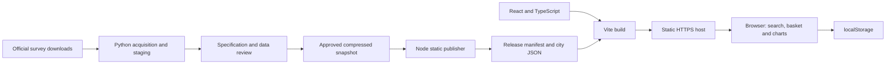

# Architecture

Japan Price Basket is a static application. Official survey files are reviewed
and published as versioned datasets before delivery; visitors select a city and
calculate basket costs in their browser. The public website needs no application
server, database or source API credential.

## System boundaries

| Layer                  | Responsibility                                                                                              |
| ---------------------- | ----------------------------------------------------------------------------------------------------------- |
| `scripts/`             | Acquire evidence, parse native formats, stage review, publish approved data and package artifacts.          |
| `data/fixtures/`       | Approved compressed snapshot and its checksum receipt, sufficient for an offline data build.                |
| `packages/domain/src/` | Runtime schemas, product eligibility, decimal calculations, dated quantity conversions and search metadata. |
| `apps/web/src/`        | Bilingual controls, local persistence, dataset loading, charts, equivalent tables and source disclosures.   |
| `tests/`               | Calculation, ingestion, integrity, persistence, accessibility and browser-flow regression checks.           |
| `ops/`                 | Static serving configuration examples; deployment configuration is separate from application behavior.      |

Acquisition and review must not run as part of an ordinary visitor request.
Publication never calls upstream APIs. Build output is generated, not edited.
See [Data](DATA.md) for provenance and comparison rules and
[Development](DEVELOPMENT.md) for contributor commands.

## Dataset publication

`scripts/publish_snapshot.mjs` verifies the approved compressed fixture checksum
before decompressing it. It derives a content-based dataset identifier and emits
`/data/<releaseId>/manifest.json`, one JSON file per city scope, and the small
`/data/current.json` discovery pointer. Each city file has a manifest SHA-256.
Historical geographic identities remain separate scopes.

The full snapshot is approximately 1.2 GB when decompressed, beyond Node's
single-string limit. `scripts/read_approved_fixture.mjs` validates and indexes
JSON directly in a byte buffer, then materializes one city's series at a time.
It is not a streaming decompressor: publication still needs several GB of free
memory. Build and data processing belong on a development machine or build
runner, rather than a small serving host.

Publication is deterministic for an approved snapshot. The publisher cleans
older generated dataset folders in its local output; production release
retention must be implemented separately and must not use that cleanup routine.

## Browser loading and trust

On startup, the application validates the discovery pointer and release
manifest. It loads the selected city's file, verifies its SHA-256 using Web
Crypto, validates the runtime schema and checks release and city identities.
City requests are cancelled when superseded. The browser does not download the
entire national observation archive or request prices from e-Stat.

HTTPS is required outside localhost for the Web Crypto secure context. Hashes
detect mismatched or damaged data; they do not replace transport security or
provide authenticity independent of the manifest served by the same host.

## Calculations and persistence

Domain calculations use `decimal.js`; rounding is reserved for display. A
basket has fixed products and quantities across its selected monthly interval.
Unavailable required items make the basket unavailable. Observed prices,
reviewed carries and estimated quantity conversions retain distinct status.
Graphs and tables consume the same result model.

Search uses reviewed names, aliases and dated specifications in the selected
interval, then applies city, coverage and estimate-mode eligibility. Brand text
in a dated survey definition does not establish a separate brand price series.

The current basket, language, date mode and estimate mode are stored in
`localStorage`. Restored and imported records are schema-validated and bounded;
storage failure preserves the current session. No account, cookie, analytics
event or basket upload is required. A changed dataset creates a persistent
notice until acknowledged. A latest-end selection follows the included source
cutoff; a fixed-end selection remains fixed.

## Delivery boundary

The implemented output is a static `dist/` directory. A Docker/GHCR, K3s and
minimal Flux delivery design is specified in [Operations](OPERATIONS.md), but
the repository does not yet provide a Dockerfile or Kubernetes manifests.
Production rolling updates require frontend release pinning and retained shared
assets; the current mutable discovery pointer alone does not satisfy that
contract. Serving multiple replicas on one host does not create host redundancy.

Changes must preserve schema and dataset compatibility, source traceability,
both languages, chart/table parity, unavailable states and bounded persistence.
Validation includes TypeScript, formatting, domain/storage tests, Python ingestion
tests and production browser flows. Chromium and mobile emulation cover the full
flow suite; Firefox and WebKit cover selected completion flows. Emulation does
not establish performance or accessibility on every physical device.
